<div align="center">

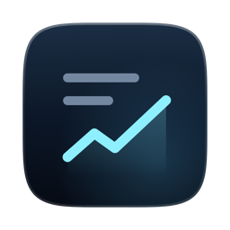

# Tearsheet

**Type an S&P 500 ticker. Get one research report in which every claim is cited.**

A free Mac app. Code works out the numbers and the Buy/Hold/Sell rating from public data.<br>
Your own Claude Code or Codex reads the filings and writes the text.

[](#what-you-need)
[](#faq)
[](#what-you-need)
[](LICENSE)

[Get it](#get-tearsheet) · [How the rating works](#how-the-rating-works) · [How accurate is it?](#how-accurate-is-it) · [What leaves your Mac](#what-leaves-your-mac) · [FAQ](#faq)

</div>

<br>

<picture>
  <source media="(prefers-color-scheme: dark)" srcset="docs/images/report-dark.webp">
  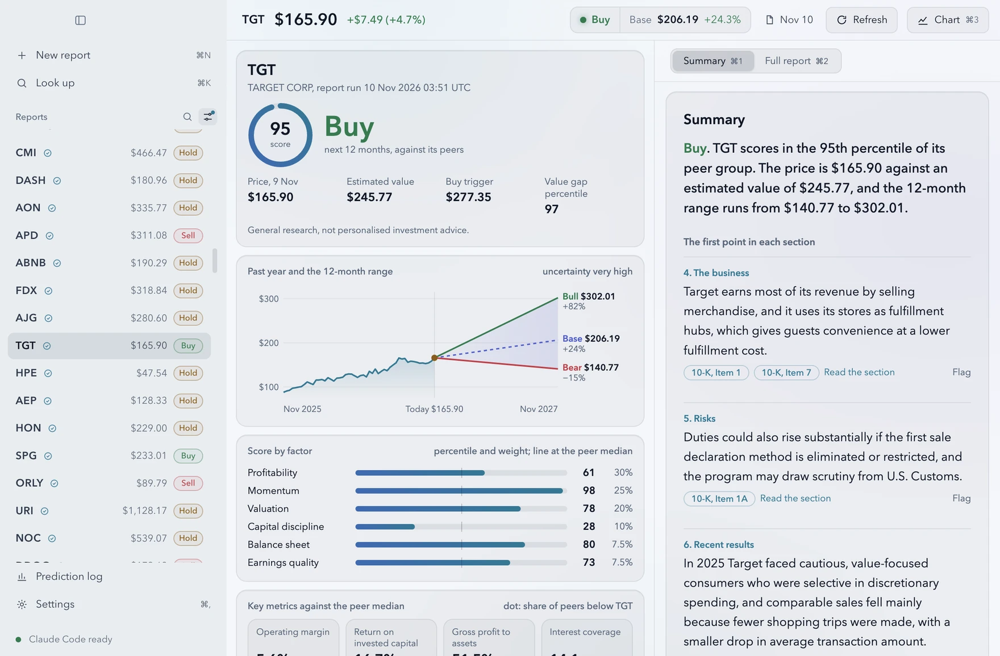
</picture>

> [!WARNING]
> **Research data, not investment advice.** Tearsheet gives general research, not advice tailored to you. It doesn't claim to beat the market, and it doesn't trade. Check the sources and make your own decisions.

## What it does

- **One report per company.** Type a ticker or a name, like NVDA or Nvidia. A few minutes later you have a full report.
- **Every claim is cited.** Each point links to the filing section or press release it came from, so you can check it in one click.
- **Code makes the rating, not AI.** The score, the Buy/Hold/Sell rating and the 12-month price range all come from code and public data. The AI is never asked for a number.
- **An honest range.** Each report gives a bear, base and bull price for 12 months from now, and says how uncertain it is.
- **A record you can't edit.** The first report on each company is logged as a prediction and graded at 3, 6 and 12 months.
- **Runs on your Mac.** No account, no server, no tracking. It uses the Claude or ChatGPT plan you already pay for and free data (SEC, Massive, FRED).

## A closer look

### The report

A summary up top, then the full report: the business, risks, recent results, news and views, industry trends, and what to watch. Open the chart beside it to see the price, its peers, the S&P 500, the filings the report read and the price that would change the rating. **Key numbers** under the chart compare the company with the median of its peers.

<table>
  <tr>
    <td width="64%">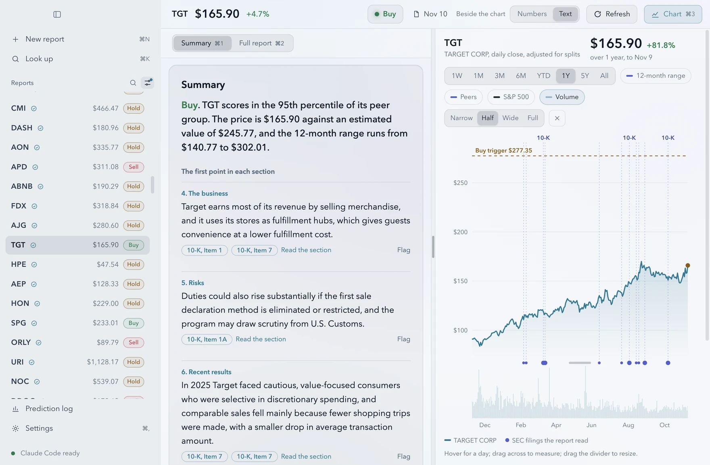</td>
    <td width="36%">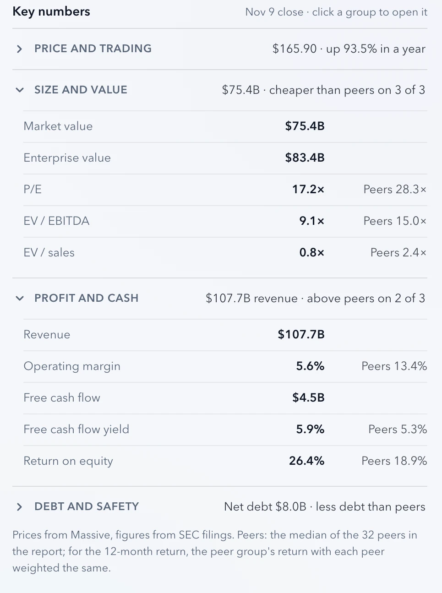</td>
  </tr>
</table>

### Downloads: PDF, slide deck and Excel

Every report saves as a PDF company note, a slide deck or an Excel workbook with the numbers behind it.

<p align="center">
  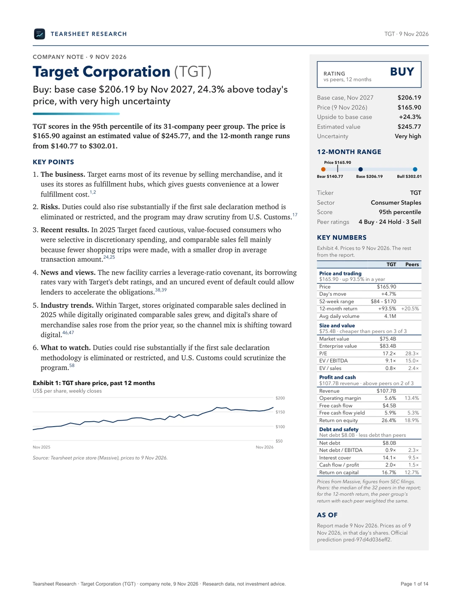
</p>

### The prediction log

Every official prediction, with filters, its due grades, and a chart that compares any of them with the S&P 500. Results say "descriptive, not conclusive" until enough have been graded to mean something. Export the whole log as a CSV.

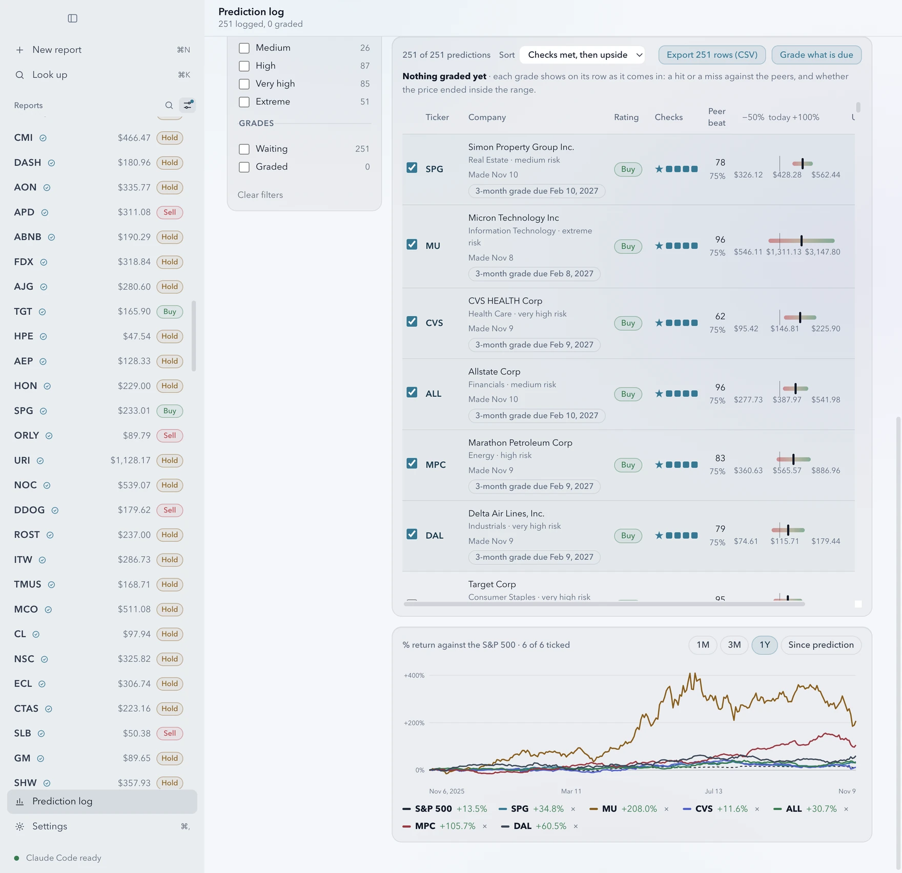

### The report line

Queue a few companies, a whole sector or all of the S&P 500. Tearsheet writes the reports one after another, skips companies with a recent report, and waits for your AI plan's usage limit to reset when it runs low.

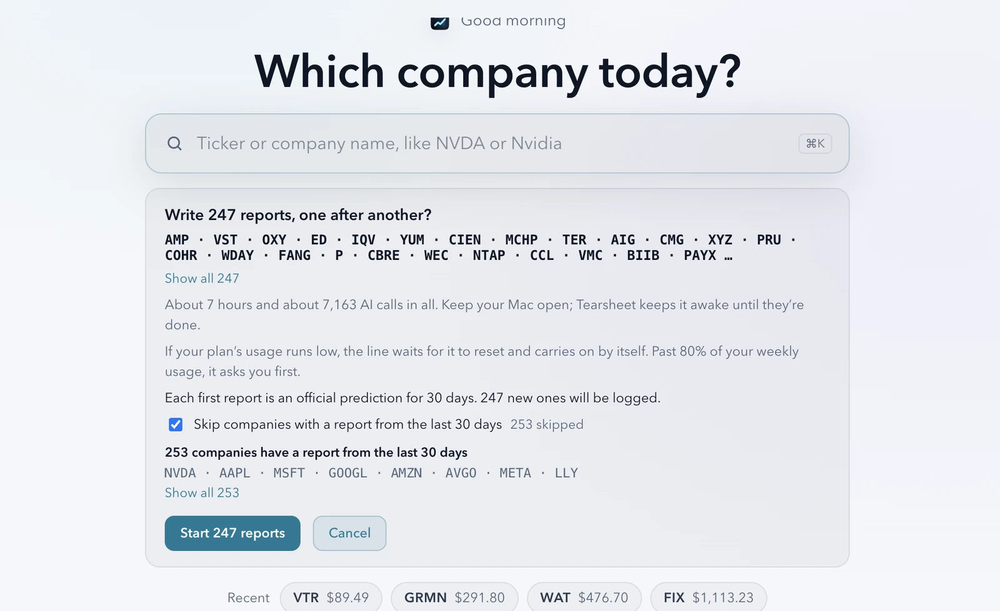

### 20+ looks, light and dark

Pick a look, then change the accent colour, text size, glow and corners. Or import a theme from a file.

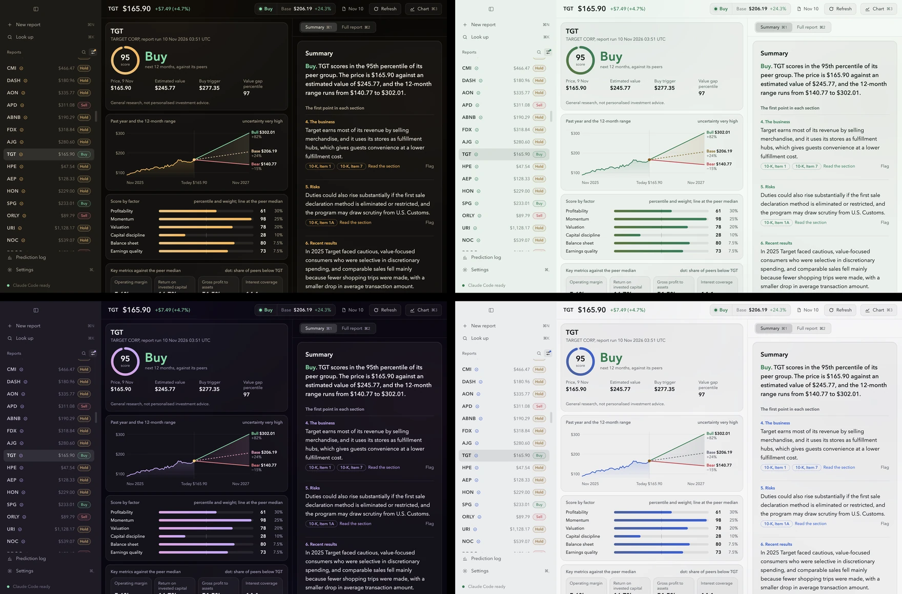

<table>
  <tr>
    <td>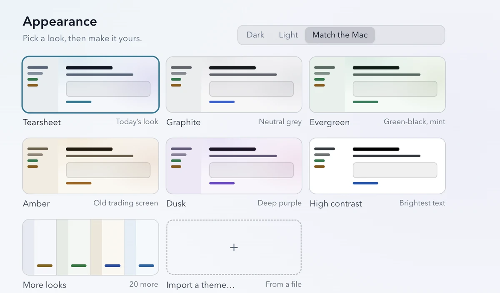</td>
    <td>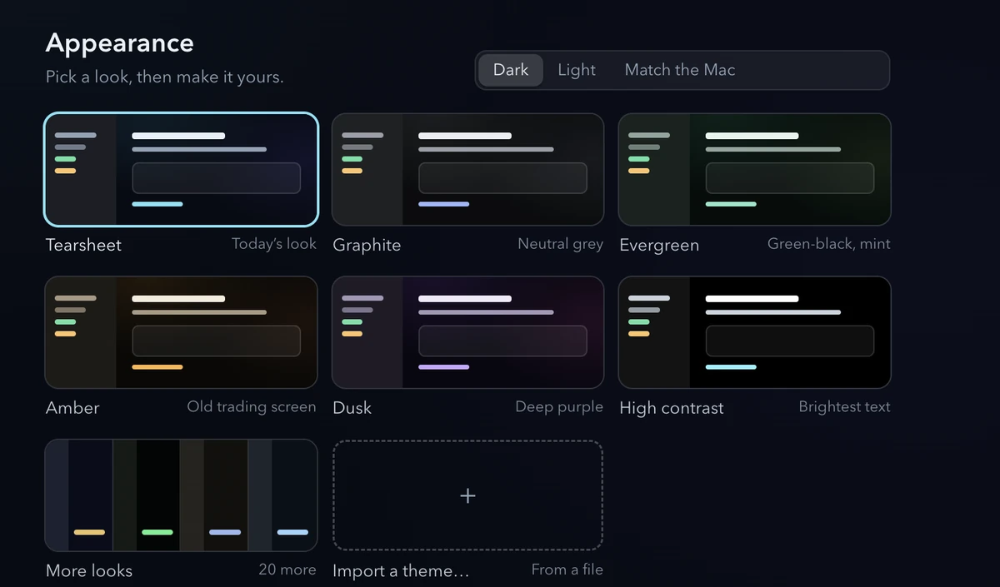</td>
  </tr>
</table>

### One setup screen

The first time you open it, one screen finds your AI tool, offers to install it if it's missing, and asks for your free price key. It fills in what it can by itself.

<p align="center">
  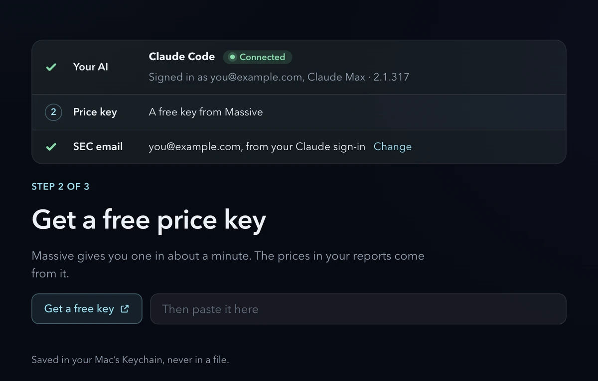
</p>

## Get Tearsheet

### What you need

- **A Mac with Apple silicon** (M1 or later). Intel Macs aren't supported.
- **Claude Code or Codex,** signed in with your Claude or ChatGPT plan. Setup can install either one for you. With both, each report's draft is also checked by the other tool.
- **A free Massive key** for prices. Without it, reports can't be rated. Setup links you to the sign-up page; it takes about a minute.
- **A free FRED key** for economic figures. Optional: reports leave those figures out without it.
- **A contact email for SEC,** which asks every program that downloads filings for one. Setup fills it in from your Claude sign-in, and it goes only to SEC.

Keys are kept in your Mac's Keychain, never in a file.

### Download

Download the `.dmg` from [Releases](https://github.com/LBB2005/Tearsheet/releases) and drag Tearsheet to Applications.

Tearsheet isn't signed with an Apple Developer ID yet, so macOS blocks it the first time. To open it:

1. Double-click Tearsheet. When macOS says it couldn't check it, click **Done** (not Move to Trash).
2. Open **System Settings → Privacy & Security**, scroll to Security, and click **Open Anyway** next to Tearsheet. Do it soon after step 1; the button doesn't stay long.
3. Click **Open Anyway** again, and type your Mac password if asked.

The full steps, including what to do if a second box names Tearsheet Engine, come in the download as "How to open Tearsheet.txt".

### Build from source

You need macOS on Apple silicon, Node.js and npm, Python 3.12 and [`uv`](https://docs.astral.sh/uv/). From the repository root:

```bash
cd engine && uv sync && cd ../app && npm install && npm run build && npm start
```

To make a `Tearsheet.app` you can double-click (about 760 MB, with its own Python inside):

```bash
cd app && npm run package
```

It lands in `app/dist/mac-arm64/`. This build is signed ad hoc, so it is for the Mac it was built on. [For developers](#for-developers) has the rest.

## How the rating works

Code makes the rating. The AI only writes the text around it.

1. **Data.** Code downloads the company's filings from SEC, daily prices from Massive and economic series from FRED.
2. **Peers.** The company is compared with the 40 largest companies in its sector.
3. **Score (0–100).** Six factors, each ranked against the peers: profitability (30%), momentum (25%), valuation (20%), capital discipline (10%), balance sheet (7.5%) and earnings quality (7.5%). A score of 95 means it ranks in the 95th percentile of its peer group.
4. **Value gap.** Code estimates what the company is worth three ways (discounted cash flow, residual income and peer multiples) and compares that with the price. The 12-month base case assumes a third of the gap closes in a year. The bear and bull cases are the 10th and 90th percentiles of a range set by the stock's volatility.
5. **Rating.** It is relative to the peers, over 12 months:
   - **Buy:** the value gap ranks near the top of the peer group, and the score is at least 60.
   - **Sell:** the value gap ranks near the bottom, and the score is 40 or less.
   - **Hold:** everything else.

   The more uncertain the stock, the bigger the lead it needs. Red flags (a restatement, a material weakness, going-concern doubt, or a big change in the risk factors) cap the rating at Hold.
6. **Text.** Your AI tool reads the filings and press releases and writes the six sections. It runs with no tools and is never asked for a number. Code, and a second AI pass, check every claim against its source before you see it.
7. **Record.** Each company's first rated report in any 30 days is an official prediction. It can't be changed afterwards, and it is graded against the peers at 3, 6 and 12 months.

"Buy" means "expected to do better than its sector peers", not "expected to go up". Every number can be traced back, and a past run can be replayed from its stored inputs to check that the numbers come out the same. The full method is in the design doc, [§7 Score, range and rating](docs/designs/tearsheet.md#7-score-range-and-rating).

## How accurate is it?

**We don't know yet, and Tearsheet says so.**

- **There is no track record yet.** The first official predictions were logged in November 2026, and their first 3-month grades come due in February 2027.
- **Expect modest results.** For large US stocks, the best published models explain under 5% of a stock's 12-month return. Tearsheet aims to be accurate, traceable and honest about uncertainty, not to out-predict anyone.
- **Graded in the open.** A Buy is a hit if it beats its peers; a Sell, if it trails them; a Hold, if it ends close to them. The log also checks how often prices end inside the bear-to-bull range (the target is 80%), and compares the ratings with random ratings and with "always Hold".
- **Labelled until it counts.** Results say "descriptive, not conclusive" until 200 predictions have been graded at 12 months, and they always show their margins of error.

## FAQ

**Is this financial advice?**
No. Reports are general research about public companies, not advice for your situation. Tearsheet doesn't know your goals or your portfolio, and it doesn't trade.

**What does it cost?**
The app is free and open source. The data is free. The AI runs on the Claude or ChatGPT plan you already have, so reports use some of that plan's usage. A full report makes about 25 to 45 AI calls.

**Which companies does it cover?**
The S&P 500: large US companies. The list ships with each release.

**Where does my data go?**
It stays on your Mac, apart from the requests listed in [What leaves your Mac](#what-leaves-your-mac). Tearsheet sends nothing to its author.

**Can I check a claim?**
Yes. Every point links to its source. If one looks wrong, click **Flag** next to it.

**Why does macOS block it?**
It isn't signed with an Apple Developer ID yet. See [Download](#download) for the steps.

**Does it work on Windows or on an Intel Mac?**
No. Only on Macs with Apple silicon.

## What leaves your Mac

Nothing leaves your Mac except what this table lists (design, Technical Plan §12; Settings → Privacy shows the same list, from `SERVICES` in `engine/src/tearsheet/server.py`). Tearsheet sends nothing to its author: no accounts, no usage tracking, no crash reports. Reports, the prediction log, raw downloads and keys stay on your computer.

| Service | Key needed | Cost | What is sent |
| :-- | :-- | :-- | :-- |
| SEC EDGAR | None. Each request carries your contact email, which goes only to SEC | Free | Requests for the company's and its peers' filings |
| Massive | Your free key | Free plan | The tickers researched and their peers, and whole-market daily prices |
| FRED | Your free key | Free | Requests for five economic series |
| Claude Code (Anthropic) or Codex (OpenAI) | Your own sign-in | Your existing plan | The text of filings and press releases, the numbers sent with that text, draft sections, and a web search for recent news about the company. Your plan's own privacy terms apply. Codex also loads your own `~/.codex/AGENTS.md` and sends it to OpenAI with each call (Codex has no setting to stop it). Tearsheet turns each tool's session history off. |
| News sites | None | Free | Nothing unless you open a link. Tearsheet lists their articles as links and doesn't download them. |
| GitHub (Tearsheet's off switch) | None | Free | One plain request at each launch, with no personal data |
| claude.ai and chatgpt.com install scripts | None | Free | A download of Claude Code's or Codex's install script, only when you press Install |

Most news sites' terms forbid automated reading, so by default section 7 reads only the company's own press releases from SEC and lists other coverage as links. `tearsheet-engine set-setting news_articles on` turns article reading back on for the allowlisted sites; use it only where their terms allow it. Tearsheet also no longer downloads the iShares holdings file (BlackRock's site terms forbid automated copying): the S&P 500 list ships with each release. The checks behind these choices are in [docs/launch/launch-readiness.md](docs/launch/launch-readiness.md).

This product uses the FRED® API but is not endorsed or certified by the Federal Reserve Bank of St. Louis. FRED's terms of use: <https://fred.stlouisfed.org/docs/api/terms_of_use.html>.

## Status

Tearsheet is young. It was built for personal use and is now being tried by a few friends. The rating rules use first-draft settings that are still being checked, and the Goal 1 test (10 real reports, checked by hand) is under way. Progress and open questions: [docs/phase1-progress.md](docs/phase1-progress.md). The design: [docs/designs/tearsheet.md](docs/designs/tearsheet.md).

## For developers

<details>
<summary><b>Terminal mode</b></summary>

<br>

The engine also runs from the terminal. From the repository root:

```bash
cd engine && uv sync && cd ..
uv run --project engine tearsheet-engine set-key massive
uv run --project engine tearsheet-engine set-setting sec_contact_email you@example.com
uv run --project engine tearsheet-engine lockdown-check
```

Then:

```bash
uv run --project engine tearsheet-engine run AAPL --full
uv run --project engine tearsheet-engine replay <run ID>
uv run --project engine tearsheet-engine spot-check
uv run --project engine tearsheet-engine goal1
uv run --project engine tearsheet-engine grade
```

`run` prints the path of the HTML report. `replay` re-runs a run's code steps from its stored inputs and checks that the numbers are identical. `spot-check` walks you through the citations to check and asks the Goal 1 question, and `goal1` prints the tally. `set-key` reads the key from a hidden prompt. `lockdown-check` checks that Claude Code runs with no tools, no user settings and your subscription sign-in (`--tool codex` checks Codex). Every command takes `--data-dir`. The default data folder is `~/Library/Application Support/Tearsheet/`.

The Phase 0 test scripts and their commands are listed in [docs/phase0-results.md](docs/phase0-results.md).

</details>

<details>
<summary><b>The Mac app in development</b></summary>

<br>

```bash
cd app && npm install && npm run build && npm start
```

It starts the engine with `uv run tearsheet-engine serve` from this repository, and uses the same data folder as terminal mode. `npm run dev` runs it with hot reload.

`npm run package` makes `app/dist/mac-arm64/Tearsheet.app` with the engine and its own Python 3.12 inside (`scripts/build-engine.sh`), so it needs no `uv` or Python to run. It uses the same data folder and Keychain entries as `npm run dev`; run one or the other, not both. Signing with an Apple Developer ID, notarization and auto-update come later.

A packaged build ignores the development and test switches (`TEARSHEET_DATA_DIR`, stand-in AI tools, hidden windows and the rest). For hidden checks on a copy of the data, make a test build instead with `npm run package:test`; [docs/test-builds.md](docs/test-builds.md) says how the two differ.

</details>

<details>
<summary><b>Tests</b></summary>

<br>

```bash
cd engine
uv run pytest
uv run ruff check . ../scripts
```

The tests run offline. Tests marked `live` are skipped unless you run `uv run pytest -m live`. The app's tests run with `cd app && npm test`.

</details>

## Licence

MIT. See [LICENSE](LICENSE). The software Tearsheet includes or adapts is listed in [THIRD-PARTY-NOTICES.md](THIRD-PARTY-NOTICES.md).

The screenshots show real reports made with free public data, for illustration only. They aren't recommendations.
